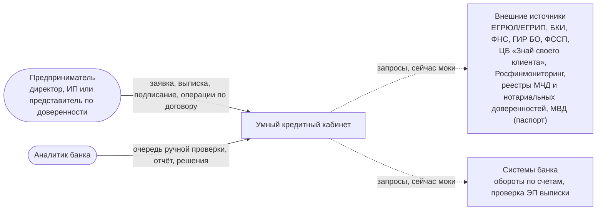
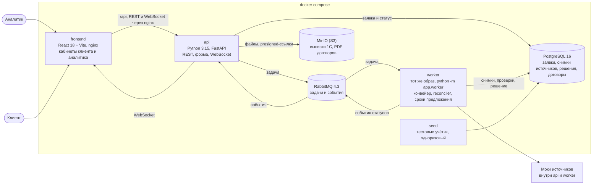
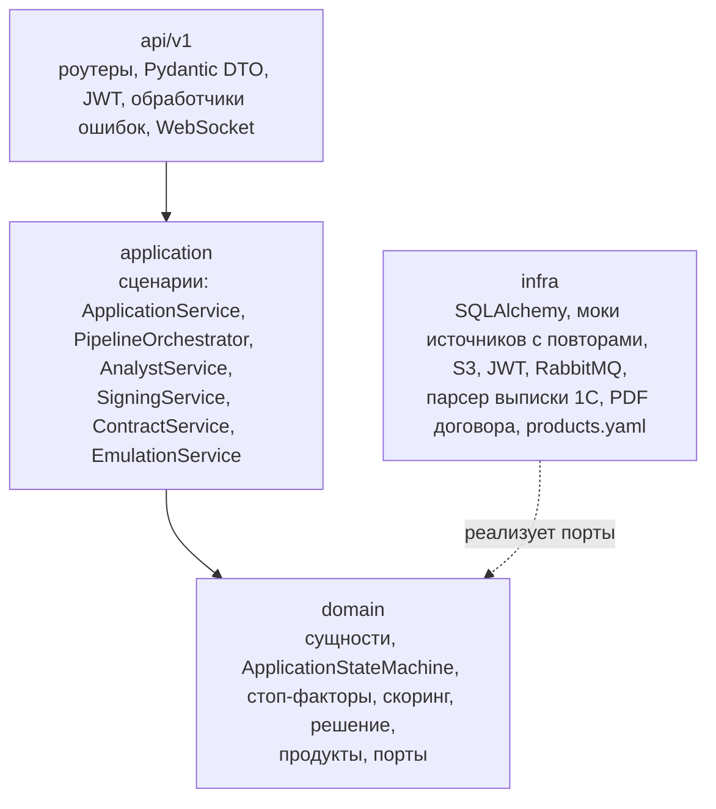

# Архитектура

Цифровой кредитный конвейер для малого и микробизнеса. Предприниматель подаёт заявку в кабинете, сервис собирает данные из источников, проверяет стоп-факторы, считает скоринг и принимает решение. Нестандартные случаи разбирает аналитик банка. После подписания клиент работает с договором: график, досрочное погашение, транши кредитной линии.

Здесь собрана общая картина. Классы, порты, конвейер и последовательности подробно описаны в `backend/docs/BACKEND_SPEC.md`, контракт API — в `backend/docs/API.md`.

## Контекст

Все внешние интеграции смоделированы: за каждым источником стоит доменный порт (`backend/app/domain/ports.py`) и мок-адаптер на синтетических данных (`backend/app/infra/mocks`). Реальную интеграцию можно подставить за тот же порт без правок домена. Список источников и форматы их ответов: `docs/data-sources/README.md`.

## Контейнеры

Всё поднимается одной командой `docker compose up --build -d` из корня репозитория.

| Контейнер | Что делает |
|---|---|
| `frontend` | отдаёт собранное SPA и проксирует `/api` (вместе с WebSocket) на `api`, поэтому браузер ходит на один адрес |
| `api` | JWT, синхронная проверка формы, запись заявки, постановка задачи в очередь, WebSocket статусов. Применяет миграции при старте |
| `worker` | берёт задачу из `applications.process`, опрашивает источники с повторами, проверяет стоп-факторы, считает скоринг, принимает решение, публикует события. Там же reconciler зависших заявок и истечение одобрений через 7 дней |
| `rabbitmq` | очередь задач `applications.process` с DLQ и обмен событий `applications.events` |
| `postgres` | основная БД, модель в `docs/DATA_MODEL.md` |
| `minio`, `minio-init` | S3-хранилище и создание бакетов `credit-files`, `credit-contracts` |
| `seed` | создаёт демо-учётки и завершается |

## Слои бэкенда

Зависимости идут только внутрь: домен не знает про FastAPI, SQLAlchemy, S3 и RabbitMQ. Реализации связываются с портами в одном месте, `backend/app/main.py`.

## Как проходит заявка

1. Клиент заполняет анкету: компания подтягивается из ЕГРЮЛ/ЕГРИП по ИНН, продукт подбирается по цели. Представитель по доверенности сначала подтверждает полномочия (МЧД или нотариальная).
2. `POST /applications/submit`: `api` проверяет форму, переводит заявку в `SUBMITTED`, ставит задачу в RabbitMQ и сразу отвечает `202`.
3. `worker` переводит заявку в `CHECKING` и по шагам опрашивает источники. Каждый шаг уходит клиенту по WebSocket, поэтому в кабинете видно, что сейчас проверяется.
4. Итог: отказ по стоп-фактору, дозапрос (например, выписка короче 6 месяцев), ручная проверка (источник не ответил, залог или сумма больше 5 млн) или скоринг с решением: одобрение, контрпредложение, отказ.
5. Аналитик видит очередь ручной проверки и полный отчёт: ответы всех источников, сравнения, факторы скоринга. Он одобряет, делает контрпредложение, дозапрашивает документы, отказывает или запускает повторную проверку, комментарий обязателен.
6. Клиент принимает предложение и подписывает договор кодом. Создаётся договор с PDF в S3, дальше идут операции и эмуляция времени для демо.

Статусы и переходы: `docs/STATE_DIAGRAM.md`. Последовательности со всеми участниками: `backend/docs/BACKEND_SPEC.md`, раздел 17.
