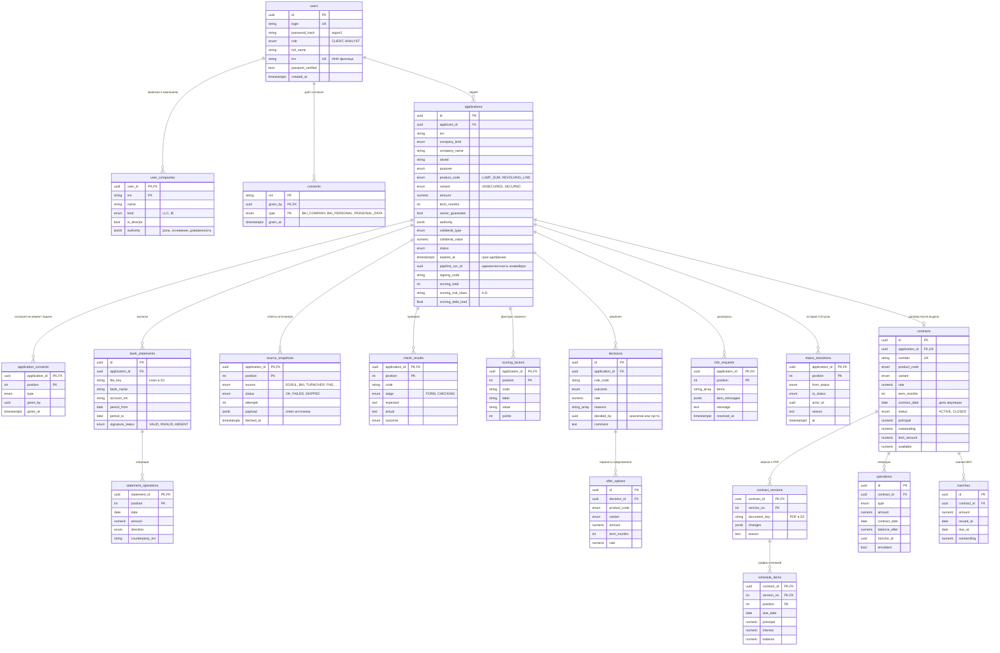

# Модель данных

PostgreSQL 16, схема создаётся миграциями Alembic (`backend/alembic/versions`), ORM-модели лежат в `backend/app/infra/db/models.py`. Файлы (выписки 1С и PDF договоров) хранятся в S3 (MinIO), в БД остаются только ключи объектов. Доменная модель, из которой собираются эти таблицы, описана в `backend/docs/BACKEND_SPEC.md`, раздел 4.

Отдельно от схемы заявок:

| Таблица | Назначение |
|---|---|
| `audit_log` | кто, что и над каким объектом сделал (`actor_id`, `action`, `target_id`, `details`), в том числе каждое действие аналитика с комментарием |
| `mock_failures` | включённые поломки моков по паре «источник, ИНН» для демо (`/dev/mocks/failures`), общие для `api` и `worker` |

Соглашения:

- деньги хранятся в `numeric(18,2)`, ставки в `numeric(5,2)`, в API они уходят строкой (`"3600000.00"`);
- перечисления (`enum` на схеме) хранятся строками `varchar(32)`, набор значений задаёт код, а не тип в БД;
- время везде `timestamptz` в UTC;
- дочерние таблицы заявки и договора упорядочены полем `position` и удаляются каскадом вместе с родителем;
- ответы источников хранятся как есть в `source_snapshots.payload`: по ним аналитик видит, что именно вернул каждый реестр, а повторный запрос в источник не нужен.
