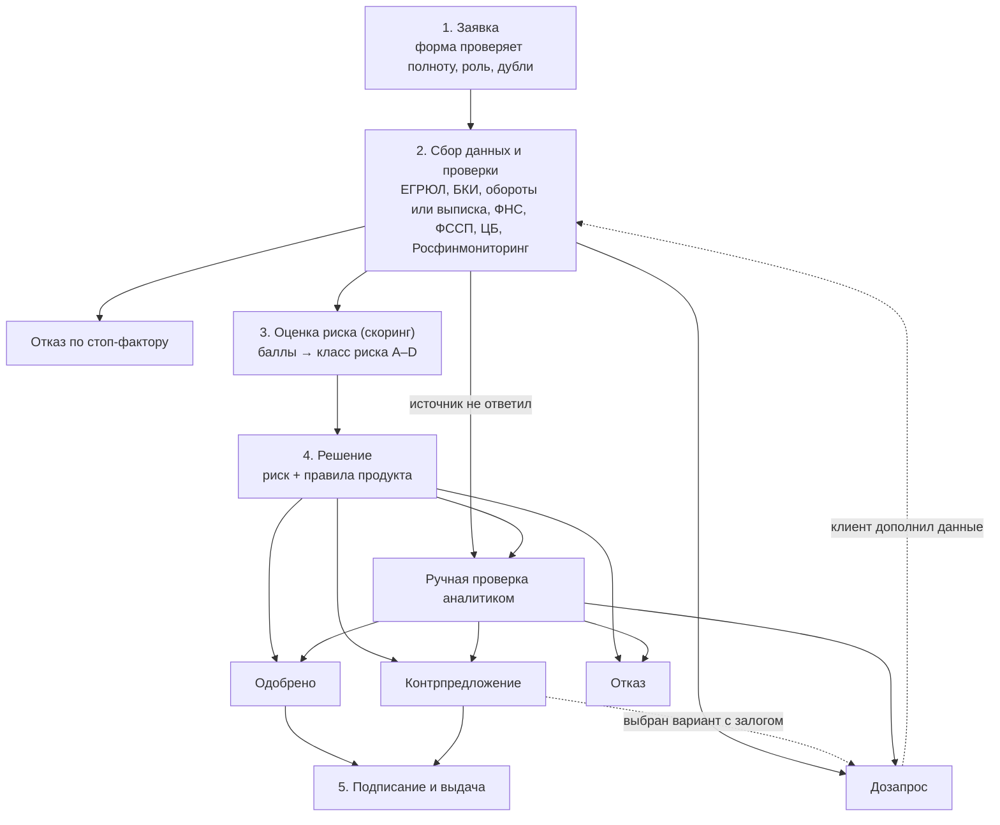
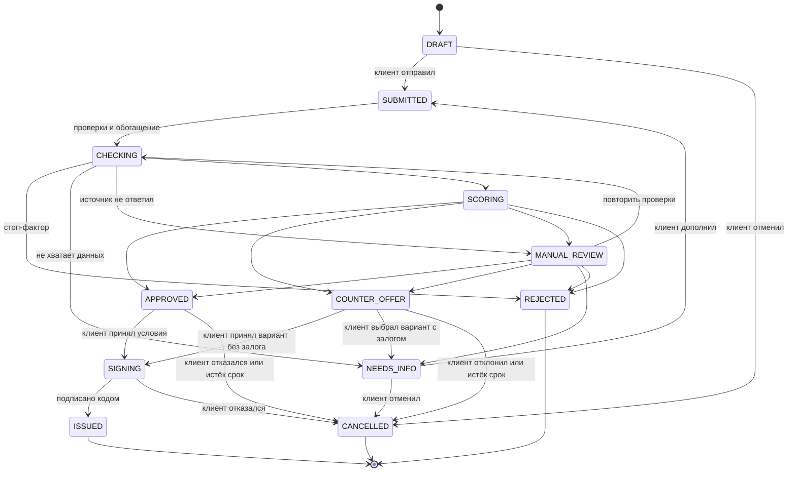
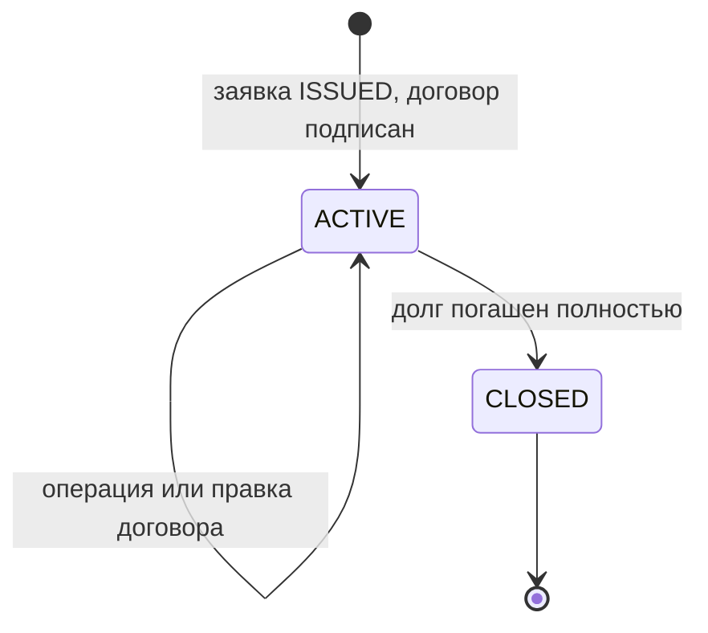

# SCOPE — Умный кредитный кабинет предпринимателя

> Зафиксированный скоуп MVP

---

## 0. Как работает конвейер (общая схема)

Банк отвечает на один вопрос: «вернёт ли клиент деньги и на каких условиях давать не страшно». Скоринг даёт **уровень риска**, решение — **вывод из риска с учётом продукта и правил банка**. Это разные шаги, кейс просит их различать (стр. 14–15).

Шаги 1, 2 и 4 схемы — это этапы 1, 2 и 3 проверок из раздела 4.

**Словарь:**
- **Стоп-фактор** — причина отказа при любом скоринге (например, компания ликвидирована). Полный список — раздел 4.
- **БКИ** — бюро кредитных историй: сколько клиент должен и как платил раньше.
- **Долговая нагрузка** — доля выручки, которая уходит на платежи по кредитам.
- **Андеррайтер / кредитный аналитик** — сотрудник, который вручную разбирает нестандартные случаи.
- **Контрпредложение** — «столько не дадим, а вот столько или на дольше — дадим».

---

## 1. Для кого и зачем

**Пользователь:** руководитель компании микро- или малого бизнеса или индивидуальный предприниматель, без банковской экспертизы. Кто именно может подать заявку — раздел 3.

**Job to be done:**
> Когда моему бизнесу нужны деньги на конкретную задачу, я хочу быстро понять, какой кредит мне подходит, подать заявку и видеть, что с ней происходит, — чтобы не тратить время на звонки, визиты и повторный ввод данных.

**Боли пользователя и чем мы их закрываем:**

| Боль | Чем закрываем |
|---|---|
| Непонятно, какой продукт выбрать под задачу и на какую сумму вообще можно рассчитывать | подбор продукта по цели, предварительные предложения с суммой, лимит от выручки |
| Приходится вводить данные, которые у банка и так есть или есть в госреестрах | автоподтягивание из ЕГРЮЛ/ЕГРИП, БКИ и оборотов по счёту |
| После подачи заявка — «чёрный ящик», статус непонятен | смена статусов почти в реальном времени и история заявки |
| Отказ или изменение условий без объяснения причин | объяснение факторов скоринга, контрпредложение вместо отказа |

**Ценность для банка:** меньше ручной работы на стандартных заявках, аналитик тратит время только на нестандартные случаи, все данные и решения в одном месте.

---

## 2. Продукты

Названия и структура — как в линейке Альфа-Банка для бизнеса.

| # | Продукт | Цель | Механика выдачи |
|---|---|---|---|
| 1 | Кредит одной суммой (оборотный кредит) | пополнение оборотных средств, развитие, рефинансирование | одна выдача всей суммы, погашение по графику |
| 2 | Возобновляемая кредитная линия (ВКЛ) | только пополнение оборотных средств | открывается лимит, деньги берутся траншами, погашенное снова доступно |

### Варианты без залога и с залогом

У каждого продукта два варианта со своими условиями: с залогом ставка ниже, а сумма и срок больше.

| Продукт | Вариант | Сумма | Срок | Ставка* | Лимит от выручки** |
|---|---|---|---|---|---|
| Кредит одной суммой | без залога | 300 тыс – 30 млн ₽ | 12–60 мес | 23,5–29,5% | 30% годовой |
| Кредит одной суммой | с залогом | 500 тыс – 150 млн ₽ | 12–120 мес | 21,5–27,5% | 50% годовой |
| ВКЛ | без залога | лимит 300 тыс – 30 млн ₽ | договор на 18 мес | 23,5–29,5% | 30% годовой |
| ВКЛ | с залогом | лимит 500 тыс – 60 млн ₽ | 60 мес | 23–29% | 50% годовой |

\* Нижние границы и суммы — с сайта Альфа-Банка. Верхние границы ставок условные: нужны для правил решения (раздел 6). Скидки за «Защиту бизнеса» и подписку не моделируем.

\*\* Лимит от выручки — наше допущение для правил решения (раздел 6), у банка такой цифры в открытом доступе нет.

**Кредит одной суммой.** Погашение в MVP — аннуитет (равные платежи). У банка есть и дифференцированный график — в Could.

**ВКЛ.** Транш от 50 тыс ₽, срок транша — 6 месяцев. Проценты платятся ежемесячно, основной долг по траншу — в конце его срока. Договор без залога продлевается автоматически. С залогом брать транши можно до момента за 6 месяцев до конца срока линии.

**Без залога.** Для ИП — без поручителей. Для ООО — поручительство собственника (галочка в анкете).

**С залогом.** Клиент указывает тип залога (недвижимость, транспорт, оборудование, товары в обороте), описание и оценочную стоимость. Необеспеченная часть — не больше 50% суммы, то есть оценочная стоимость залога должна быть не меньше половины суммы; это проверяет форма. Такие заявки всегда идут на ручную проверку (раздел 4, этап 3): аналитик подтверждает описание и оценку залога.

Продукты и варианты описываем конфигом (параметры и правила), а не кодом, чтобы третий продукт добавлялся без переделки конвейера.

На демо залог даёт контрпредложение не только по риску: без залога одобрим меньше, с залогом — всю запрошенную сумму (сценарий 3).

**Подбор продукта:** клиент выбирает цель («разовая закупка», «развитие», «рефинансирование», «регулярные закупки», «сезонный разрыв»), система предлагает подходящий продукт и объясняет почему. Можно выбрать продукт и вручную, но только среди подходящих под цель: ВКЛ — только для пополнения оборотных средств.

### Другие продукты (не берём в MVP)

| Продукт | Суть | Почему не берём |
|---|---|---|
| Невозобновляемая кредитная линия (НКЛ) | транши только в первые 6 месяцев, потом только погашение | почти повторяет ВКЛ |
| Овердрафт | автоматический лимит на расчётном счёте, гасится поступлениями | почти повторяет ВКЛ, а без реального счёта механику не показать |
| Кредитная линия под госконтракт | финансирование исполнения контракта по 44-ФЗ/223-ФЗ, транши под этапы, погашение из оплаты заказчика | нужен мок реестра госзакупок и проверка контракта; кандидат на третий продукт |
| Кредит на оборудование | покупка техники, оборудование становится залогом | хорошо показывает залог; кандидат на третий продукт |
| Инвестиционный кредит | долгосрочные проекты: стройка, расширение | длинные сроки и бизнес-план, сложно уложить в простой скоринг |
| Банковская гарантия | банк гарантирует исполнение обязательств клиента | не кредит в чистом виде, другой конвейер |
| Кредит по госпрограмме (например, корпорации МСП) | льготная ставка с субсидией или гарантией государства | дополнительные критерии отбора, условия часто меняются |

### Предварительные предложения (Should)

Только для клиентов со счётом в нашем банке (мок).

1. Клиент входит в кабинет и даёт согласие на запрос кредитной истории (в реальности без согласия запрашивать БКИ нельзя).
2. Система подтягивает данные из ЕГРЮЛ/ЕГРИП, БКИ и обороты по счёту, проверяет стоп-факторы и прогоняет **тот же скоринг** в режиме предоценки по каждому продукту без залога. Сумма — меньшая из верхней границы варианта и лимита от выручки, срок — максимальный для варианта.
3. Если стоп-факторов нет и класс риска A или B — в кабинете появляется карточка: «Вам предварительно доступно: оборотный кредит до N ₽».
4. Клик по карточке → анкета **уже заполнена**, клиент только правит сумму, срок и цель.
5. Дальше обычный конвейер с полной проверкой. Финальное решение может отличаться — везде пишем «предварительно».

Если стоп-фактор есть — предложений нет, есть понятное объяснение почему. Клиент всегда может подать заявку с нуля, не пользуясь предложениями.

Технически: скоринг — одна функция с двумя режимами (`precheck` и `full`).

---

## 3. Анкета клиента

**Кто подаёт.** ФИО, ИНН физлица и паспорт пользователь указывает один раз при регистрации, тогда же паспорт проверяется на действительность (мок), а у ИНН — контрольные разряды. В анкете их не вводим, а берём из аккаунта. Заявку оформляет собственник бизнеса, генеральный директор, финансовый директор или бухгалтер, сотрудник, отвечающий за финансирование, сотрудник, работающий с банковскими продуктами, или иной уполномоченный сотрудник. В ЕГРЮЛ из них есть только руководитель (лицо, действующее без доверенности) и участники ООО; главбуха, финдиректора и выданных доверенностей там нет, а должность сама по себе права подписи не даёт. Поэтому:

- руководитель по ЕГРЮЛ и сам ИП по ЕГРИП проходят без документов, сверка по ИНН физлица;
- все остальные, включая собственника без должности директора, прикладывают доверенность: МЧД (проверка по реестру ФНС по номеру, ИНН компании и ИНН представителя) или нотариальную (проверка по реестру ФНП по дате, реестровому номеру и ФИО нотариуса);
- доверенность должна действовать, быть выдана этой компанией за подписью действующего руководителя по ЕГРЮЛ на этого заявителя и содержать оба полномочия: подачу заявки на кредит и подписание кредитного договора. Подписание проверяем сразу при подаче, иначе заявка дошла бы до одобрения и встала: подписать было бы некому;
- собственника дополнительно ищем среди учредителей в ЕГРЮЛ; если его там нет, это предупреждение, а не отказ;
- простую письменную доверенность не принимаем: онлайн её не проверить, заявитель видит подсказку оформить МЧД;
- представитель с проверенной доверенностью сам подписывает договор кодом, как руководитель.

Выбранная роль сохраняется в заявке и видна аналитику; на набор документов она не влияет.

**Вводит клиент:**
1. ИНН компании: по нему банк сам находит всё остальное (см. ниже).
2. Цель финансирования (справочник), по ней подбираем кредитный продукт, и вариант: без залога или с залогом.
3. Сумма и срок (для ВКЛ — размер лимита и срок действия линии).
4. Если основной счёт в другом банке — выписка по нему (см. «Счёт в другом банке» ниже).
5. Согласия: на запрос кредитной истории в БКИ и на обработку персональных данных.

В зависимости от варианта:
- без залога для ООО: согласие собственника на поручительство (для ИП не нужно);
- с залогом: тип, описание и оценочная стоимость залога.

**Согласие на БКИ.** Руководитель ООО даёт два согласия: от имени компании и на свою личную кредитную историю (её проверяет стоп-фактор 3). ИП даёт одно — как физлицо. Если согласие уже дано при входе ради предварительных предложений (раздел 2), повторно не спрашиваем.

**Подтягивается автоматически (моки), клиент только подтверждает:**
- по ИНН из ЕГРЮЛ/ЕГРИП: наименование, ОГРН/ОГРНИП, дата регистрации, статус, ОКВЭД, руководитель, учредители, адрес;
- из БКИ (после согласия): действующие обязательства и платежи по ним, просрочки, закрытые кредиты, обращения за кредитами;
- из внутренней системы банка: обороты по расчётному счёту → годовая выручка.

**Счёт в другом банке.** Если основного счёта у нас нет, клиент загружает выписку в формате 1С (`1CClientBankExchange`). Это текстовый файл, который выгружает любой интернет-банк, так что распознавать сканы не нужно. Проверки ИНН, периода и свежести выписки — в разделе 4.

Выписку можно подделать, поэтому подлинность подтверждаем одним из двух способов:
1. **Электронная подпись банка.** Многие банки выдают выписку, подписанную своей ЭП. Если подпись есть и верна (проверка подписи — мок), выручка подтверждена.
2. **Сверка с ФНС — только для ООО.** ООО сдают бухгалтерскую отчётность, и выручка за прошлый год есть в открытом доступе (ГИР БО, мок ФНС), согласие клиента не нужно. Выписка охватывает последние 6–12 месяцев, а отчётность — прошлый календарный год, поэтому сравниваем выручку по выписке, приведённую к году, с выручкой из отчётности. Расхождение не больше 20% — выручка подтверждена. У ИП открытой отчётности нет, для них работает только подпись банка.

Если ни один способ не сработал (у ИП — нет подписи банка), заявку не отклоняем автоматически, а отправляем на **ручную проверку** (раздел 4, этап 3). Скоринг считаем по выручке из выписки, а решение аналитик принимает по отчёту по заявке (раздел 7).

Запросить данные напрямую у другого банка мы не можем: без согласия клиента он их не раскроет (банковская тайна), а обязательных открытых API между банками пока нет. Мок API другого банка — в Could.

Выручку вручную клиент не вводит, она считается по оборотам: по нашему счёту или по выписке.

---

## 4. Проверки и источники

Проверки идут в три этапа. Порядок важен: стоп-фактор срабатывает раньше дозапроса, дозапрос — раньше скоринга, поводы для ручной проверки смотрим после скоринга.

### Этап 1. Форма — до отправки, мгновенно

Не прошла — заявка не отправляется, клиент видит подсказку в форме. В конвейер такие заявки не попадают.

| Проверка | Источник |
|---|---|
| Полнота и формат анкеты; сумма и срок в границах варианта (раздел 2) | внутренняя |
| Пользователь — руководитель компании по ЕГРЮЛ, сам ИП или представитель по действующей МЧД или нотариальной доверенности с обоими полномочиями (раздел 3); доверенность перепроверяется при каждой отправке | аккаунт + мок ЕГРЮЛ/ЕГРИП + моки реестров МЧД (ФНС) и нотариальных доверенностей (ФНП) |
| Нет другой активной заявки по этому ИНН — иначе дубли забивают конвейер (активные статусы — раздел 8) | внутренняя |
| Для варианта с залогом — оценочная стоимость залога покрывает не меньше 50% суммы (раздел 2) | анкета |
| Если счёта у нас нет — выписка загружена | внутренняя |
| Выписка по счёту этого ИНН | файл 1С |

### Этап 2. CHECKING — сбор данных, стоп-факторы, дозапрос

Конвейер запрашивает данные из моков и проверяет по порядку:
1. **Стоп-факторы** (таблица ниже) → **отказ** с причиной.
2. **Выписка короче 6 месяцев или последняя операция старше месяца** → **дозапрос** выписки за нужный период (берём до 12 последних месяцев).
3. **Подлинность выписки** (раздел 3) — результат сохраняем, повод для ручной проверки применяется на этапе 3.

**Источник не ответил.** Если мок не ответил или вернул ошибку, повторяем запрос 3 раза с паузой. Не помогло — заявка идёт на **ручную проверку** без скоринга (скоринг на неполных данных вводит в заблуждение), а в отчёте по заявке (раздел 7) видно, каких данных нет. Аналитик может отказать или запросить информацию сразу, а одобрить — только после того, как ответили все источники стоп-факторов: для этого он запускает повторную проверку, и заявка заново проходит CHECKING. Для демо у мока есть режим «сломаться» на конкретном ИНН.

#### Стоп-факторы

Любой из них означает отказ, независимо от скоринга.

| # | Стоп-фактор | Источник (мок) |
|---|---|---|
| 1 | Компания не действует: ликвидация, банкротство, реорганизация | ЕГРЮЛ/ЕГРИП |
| 2 | Бизнесу меньше 6 месяцев | ЕГРЮЛ/ЕГРИП |
| 3 | Текущая просрочка больше 30 дней: у компании, у ИП как физлица, у директора или учредителя с долей от 20% (учредители — из ЕГРЮЛ, согласия — раздел 9) | БКИ |
| 4 | Запрещённая отрасль по ОКВЭД (игорный бизнес, производство алкоголя) | ЕГРЮЛ/ЕГРИП |
| 5 | У компании или ИП операции по счетам приостановлены налоговой или есть неисполненные исполнительные производства | ФНС, ФССП |
| 6 | Красный уровень риска на платформе ЦБ «Знай своего клиента» | ЦБ |
| 7 | Компания, директор, учредитель или представитель по доверенности в перечне Росфинмониторинга (терроризм и экстремизм) — проверка обязательна по 115-ФЗ | Росфинмониторинг |
| 8 | Руководитель дисквалифицирован — по закону он не вправе руководить компанией | «Прозрачный бизнес» (ФНС) |

Реестровые данные (статус, директор, учредители, ОКВЭД, адрес) берём из ЕГРЮЛ/ЕГРИП — они обновляются ежедневно. Из «Прозрачного бизнеса» — только то, чего в ЕГРЮЛ нет: массовые адрес, руководитель и учредитель, дисквалификация, налоговая задолженность компании или ИП. Личные налоговые долги директора и учредителей там не видны — это налоговая тайна. Оба источника ведёт ФНС, поэтому сверять их между собой не нужно: расхождение означает только задержку обновления, а не риск клиента.

**Дозапрос.** Банк (система на этапе 2 или аналитик на ручной проверке) пишет, чего не хватает: например, выписки хотя бы за 6 месяцев или описания залога. Клиент догружает выписку или дозаполняет поля в кабинете, и заявка заново проходит CHECKING. Из файлов принимаем только выписку 1С.

### Этап 3. После скоринга — поводы для ручной проверки

Заявку не отклоняем, но и автоматически не одобряем — решает аналитик по отчёту по заявке (раздел 7). Класс и рекомендация системы всё равно считаются и видны аналитику.

| # | Повод | Источник |
|---|---|---|
| 1 | Вариант с залогом (раздел 2) | анкета |
| 2 | Выписка из другого банка не подтверждена (раздел 3) | выписка, моки ЭП и ФНС |
| 3 | Сумма больше 5 млн ₽ — крупные суммы система сама не одобряет | анкета |
| 4 | Смена директора или собственника меньше 6 месяцев назад | ЕГРЮЛ |
| 5 | Запись о недостоверности сведений в ЕГРЮЛ (адрес, директор или учредитель) | ЕГРЮЛ |
| 6 | Жёлтый (средний) уровень риска на платформе ЦБ «Знай своего клиента» — отказывать автоматически банк не обязан, но должен присмотреться | ЦБ |
| 7 | Задолженность компании или ИП по налогам, пеням и штрафам больше 10 тыс. ₽. Данные обновляются раз в месяц, и долг уже может быть погашен — аналитик видит сумму и дату данных и при необходимости запрашивает справку об отсутствии задолженности | «Прозрачный бизнес» (ФНС) |
| 8 | Неисполненные исполнительные производства у директора как физлица больше 10 тыс. ₽ — сигнал, но не приговор для компании | ФССП |

---

## 5. Скоринг (прозрачная балльная модель)

Каждый фактор даёт баллы, сумма баллов → класс риска. Клиент и аналитик видят разбивку по факторам.

| Фактор | Условие → баллы | Источник |
|---|---|---|
| Возраст бизнеса | < 12 мес: 0 · 12–36 мес: +10 · > 36 мес: +20 | ЕГРЮЛ/ЕГРИП |
| Долговая нагрузка (все платежи с новым кредитом / среднемесячная выручка) | < 20%: +25 · 20–40%: +10 · > 40%: −15 | БКИ, обороты или выписка |
| Сумма заявки / годовая выручка | < 25%: +15 · 25–50%: +5 · > 50%: −10 | анкета, обороты или выписка |
| Кредитная история* | без просрочек за последний год: +20 · нет истории: 0 · закрытые просрочки до 30 дней за последний год: −10 · закрытые просрочки больше 30 дней за последний год или текущая просрочка до 30 дней: −20 | БКИ |
| Закрытые кредиты без просрочек | есть: +10 · нет: 0 | БКИ |
| Отраслевой риск (ОКВЭД)** | низкий: +10 · средний: 0 · высокий: −10 | ЕГРЮЛ/ЕГРИП |
| Динамика выручки*** (два последних квартала к двум предыдущим) | падение больше 30%: −15 · иначе: 0 | обороты или выписка |
| Адрес массовой регистрации | да: −10 · нет: 0 | «Прозрачный бизнес» (ФНС) |
| Массовый руководитель или учредитель | да: −10 · нет: 0 | «Прозрачный бизнес» (ФНС) |
| Обращения за кредитами за последние 3 месяца | больше 3: −10 · иначе: 0 | БКИ |

\* Если подходит несколько условий, берём худшее. Просрочки старше года не учитываем. Текущая просрочка сверх порога стоп-фактора сюда не доходит — это стоп-фактор (раздел 4).

\*\* Условно: низкий — производство, IT, медицина; средний — торговля, общепит, услуги; высокий — строительство, туризм, грузоперевозки.

\*\*\* Нужна история оборотов за 12 месяцев. Если она короче (например, выписка за 6–11 месяцев), фактор не считается и даёт 0.

Максимум — 100 баллов.

**Классы риска:** ≥ 70 — A · 50–69 — B · 30–49 — C · < 30 — D

Платёж по новому кредиту считаем по формуле аннуитета с минимальной ставкой варианта. Для ВКЛ это упрощение: у банка долг по траншу гасится в конце его срока, а мы считаем, будто весь лимит выбран и гасится аннуитетом за срок линии (раздел 2).

---

## 6. Кредитное решение (отдельно от скоринга)

Сюда доходят заявки, прошедшие CHECKING (раздел 4, этап 2): стоп-факторы и дозапрос уже отработали. Решение учитывает не только риск, но и продукт, сумму и правила банка. Поэтому один и тот же класс риска даёт разные условия для разных продуктов.

**Ставка по классу:** A — нижняя граница диапазона варианта, B — середина, C — верхняя граница. Она же действует в контрпредложении.

Правила применяются по порядку:

1. Есть хотя бы один повод для ручной проверки (раздел 4, этап 3) → **ручная проверка**.
2. Класс D → **отказ** с объяснением факторов.
3. Класс A или B и сумма больше лимита от выручки для варианта (раздел 2) → **контрпредложение**: сумма в пределах лимита без залога или запрошенная сумма с залогом, если она укладывается в лимит варианта с залогом.
4. Класс A → **одобрено** на запрошенных условиях.
5. Класс B → **одобрено** на запрошенных условиях.
6. Класс C → **контрпредложение**: меньше сумма или дольше срок, либо другой продукт.

**Если клиент в контрпредложении выбрал вариант с залогом**, заявка уходит в дозапрос: клиент заполняет поля залога, заявка заново проходит CHECKING и по поводу «вариант с залогом» попадает на ручную проверку. Сразу на подписание она не идёт.

**После ручной проверки** ставку назначает аналитик в пределах диапазона варианта; по умолчанию подставляется ставка по классу.

---

## 7. Банковская роль

**Кредитный аналитик** (одна роль в MVP).

Видит:
- очередь заявок на ручной проверке;
- все остальные заявки, включая те, по которым система уже приняла решение автоматически;
- по каждой заявке — отчёт (см. ниже).

Может (для заявок на ручной проверке):
- одобрить и назначить ставку (раздел 6);
- сделать контрпредложение;
- запросить информацию (дозапрос);
- отказать;
- запустить повторную проверку, если источник не ответил (раздел 4, этап 2).

После выдачи аналитик может править договор: менять ставку или срок (раздел 8).

Комментарий к решению обязателен. Каждое действие пишется в историю заявки (аудит-лог).

### Отчёт по заявке

Единственное место, где собрано всё по заявке. Аналитик видит отчёт всегда: и когда решение ещё нужно принять, и когда оно уже принято (системой или аналитиком). Отчёт собирается по ходу конвейера и обновляется после дозапроса.

1. **Что предоставил клиент:**
   - анкета: продукт и вариант, цель, сумма, срок;
   - данные из аккаунта: ФИО, паспорт (проверен при регистрации);
   - согласия: на БКИ и на обработку персональных данных — с датой и тем, кто дал;
   - для варианта с залогом: тип, описание и оценочная стоимость залога; для ООО без залога: согласие собственника на поручительство;
   - выписка из другого банка, если загружена: банк, период, число операций.
2. **Что мы получили сами:** данные из всех источников раздела 4; если какой-то источник не ответил — это тоже видно.
3. **Как сравнили — каждая проверка из раздела 4:** что с чем сравнивали, значения, результат (прошла / не прошла / стоп-фактор). Например:
   - руководитель по ЕГРЮЛ ↔ ФИО из аккаунта;
   - ИНН в выписке ↔ ИНН заявки, период выписки;
   - подпись банка в выписке: есть / нет / не прошла проверку;
   - для ООО: выручка по выписке, приведённая к году ↔ выручка по отчётности в ФНС, расхождение в процентах;
   - обороты по месяцам (поступления и списания), крупнейшие плательщики и их доля в поступлениях;
   - оценка залога ↔ порог покрытия (раздел 2).
4. **Скоринг:** баллы по каждому фактору (раздел 5), сумма, класс риска, долговая нагрузка.
5. **Что решили:** какое правило из раздела 6 сработало, решение системы (одобрено / контрпредложение / дозапрос / ручная проверка / отказ), причина ручной проверки, если есть. После ручной проверки — решение аналитика, ставка и комментарий.
6. **История:** все смены статусов и действия с датой и автором (раздел 8).
7. **После выдачи:** версии договора и журнал операций (раздел 8).

Клиент видит урезанную версию, без внутренних сравнений: решение, причину и ключевые факторы (Must), полную разбивку скоринга (Should).

---

## 8. Статусы заявки и договора

**Активная заявка** — любая, кроме ISSUED, REJECTED и CANCELLED. Пока по ИНН есть активная заявка, новую подать нельзя (раздел 4, этап 1). Одобрение и контрпредложение действуют 7 дней, потом заявка автоматически переходит в CANCELLED.

**Обработка асинхронная.** После отправки заявка проходит SUBMITTED → CHECKING → SCORING → решение как фоновая задача, на каждом шаге — небольшая пауза, имитирующая обращение к внешним сервисам. Клиент видит смену статусов почти в реальном времени (опрос API раз в 2–3 секунды; WebSocket — не обязателен). Это закрывает требование кейса «динамично отображать состояние заявки» и выглядит убедительно на демо.

Каждый переход сохраняется в истории: кто, когда, из какого статуса, причина.

### После выдачи: договор и операции (эмуляция)

Заявка в ISSUED заканчивает конвейер, дальше живёт **договор**. Хотим показать весь жизненный цикл кредита, но без отдельного сервиса: у каждого договора есть **отдельная страница** в кабинете. На ней сводка по договору, кнопки операций (сумма вводится прямо на странице), журнал операций и версии договора. Каждая операция пишет запись в журнал.

**Договор** создаётся при подписании: номер, продукт и вариант, сумма или лимит, срок, ставка, график платежей. Любая правка — новая версия договора (допсоглашение): что изменилось, кто и когда. Старые версии не удаляются. Правки:
- автоматические — после частичного досрочного погашения пересчитывается график;
- ручные — аналитик меняет ставку или срок, клиент видит новую версию в кабинете. Увеличение суммы или лимита — только через новую заявку, потому что это новое кредитное решение.

**Операции:**

| Операция | Продукт | Кто выполняет | Что происходит |
|---|---|---|---|
| Получение денег | кредит одной суммой | система при выдаче | вся сумма зачисляется на счёт клиента |
| Плановый платёж | кредит одной суммой | эмулятор | списание по графику: проценты и часть основного долга |
| Частичное досрочное погашение | кредит одной суммой | клиент | долг уменьшается, график пересчитывается (уменьшаем платёж, срок прежний), новая версия договора |
| Полное погашение | оба | клиент | долг 0 → договор CLOSED |
| Открытие лимита | ВКЛ | система при выдаче | лимит = одобренная сумма, доступно = лимит |
| Получение транша | ВКЛ | клиент | от 50 тыс ₽ и не больше доступного остатка лимита, срок 6 месяцев; доступный остаток уменьшается |
| Начисление процентов | ВКЛ | эмулятор | ежемесячно по каждому непогашенному траншу |
| Погашение транша | ВКЛ | клиент (досрочно, полностью или частично) или эмулятор (в конце срока транша) | долг по траншу уменьшается, доступный остаток лимита восстанавливается |

**Режим эмуляции.** Управление временем и демо-данными вынесено в отдельную кнопку «Эмуляция» на странице договора — это режим разработчика, обычный клиент им не пользуется. В нём:
- **«Следующий месяц»** — сдвигает дату договора на месяц: проводит плановые платежи, начисляет проценты, гасит транши с истёкшим сроком;
- **«Перемотать до даты»** — то же самое в цикле до выбранной даты, например до конца срока, чтобы показать полное погашение;
- **«Сбросить демо»** — возвращает договор в состояние сразу после выдачи, чтобы сценарий можно было прогнать заново.

**Время у каждого договора своё.** Эмуляция сдвигает дату только этого договора, а конвейер заявок живёт по реальной дате. Иначе перемотка на одном договоре прогнала бы 7-дневный срок одобрений и контрпредложений у всех заявок (раздел 8) и сломала бы чужие сценарии. Сброс тоже затрагивает только этот договор.

Дата договора всегда видна на странице («Дата договора: …»), чтобы было понятно, что время сдвинуто. Так за минуту на демо видно полгода жизни кредита. Денег на счёте клиента всегда хватает — просрочки не эмулируем.

**Страница договора у клиента:** остаток долга, следующий платёж, график, по ВКЛ — лимит, доступный остаток и список траншей; журнал операций; все версии договора. Аналитик открывает ту же страницу из отчёта по заявке (раздел 7) и там же правит договор.

---

## 9. Допущения и упрощения

Обоснование — стр. 10–11 кейса («Допустимые упрощения», «Автономность»).

- Вход по тестовым учёткам, без реальной авторизации через госуслуги или банк. Проверка паспорта при регистрации — мок.
- Клиент уже обслуживается в банке (есть расчётный счёт), кроме отдельных тестовых сценариев.
- Подписание — подтверждение кодом, который показывается прямо в интерфейсе (SMS и email исключены условиями).
- Выдача — смена статуса и запись о зачислении на синтетический счёт. Для ВКЛ выдача — открытие лимита.
- Обслуживание после выдачи — эмуляция на странице договора кнопками операций и «перемоткой» времени, без отдельного сервиса и реального движения денег (раздел 8).
- Залог по существу не оценивается: аналитик подтверждает описание и оценку, указанные клиентом. Поручительство не проверяется.
- Все источники из разделов 4 и 5 (ЕГРЮЛ/ЕГРИП, БКИ, обороты по счёту, ФНС и её сервис «Прозрачный бизнес», ФССП, ЦБ, Росфинмониторинг, проверка ЭП банка в выписке, реестры МЧД ФНС и нотариальных доверенностей ФНП) — локальные моки с синтетическими данными, контракты упрощены.
- ИНН физлица из регистрации не сверяем с паспортом и ФИО: в реальном банке личность приходит из Госуслуг или КЭП.
- Личные согласия директора (на запрос его кредитной истории) и собственника (на поручительство) представитель подтверждает галочкой «согласие получено»: кабинета директора нет. Собственник, подающий сам, даёт согласие на поручительство от своего имени.
- МЧД проверяем только по записи в реестре, без загрузки XML и открепленной подписи доверителя. Мок реестра ФНП отдаёт стороны и полномочия доверенности, хотя настоящий отвечает только «найдена / отменена».
- Представителя проверяем по перечню Росфинмониторинга наравне с директором и учредителями (115-ФЗ); БКИ и ФССП по нему не запрашиваем — он не заёмщик и не поручитель.
- Согласия учредителей на запрос их кредитной истории считаем полученными.
- Скоринг — прозрачная балльная модель, не ML: объяснимость важнее точности для MVP.
- Все уведомления только внутри продукта.

---

## 10. MoSCoW

**Must — сквозной путь к пятнице вечером:**
- кабинет клиента: выбор продукта, анкета с автоподтягиванием, отправка, статус;
- моки источников стоп-факторов и скоринга (разделы 4 и 5), кроме отчётности ООО в ФНС;
- загрузка выписки 1С для клиентов со счётом в другом банке, мок ЭП банка;
- асинхронная обработка с видимой сменой статусов;
- скоринг и решение по правилам из разделов 5–6: одобрение, контрпредложение, дозапрос, ручная проверка, отказ с причиной и ключевыми факторами;
- кабинет аналитика: очередь ручной проверки, отчёт по заявке, действия из раздела 7;
- подписание кодом и выдача;
- история статусов;
- синтетические данные для 5 тестовых сценариев (раздел 12);
- подача и подписание заявки представителем по МЧД или нотариальной доверенности (раздел 3) и сценарии с представителями (раздел 12);
- `docker compose up` поднимает всё.

**Should — суббота:**
- сверка выписки ООО с отчётностью в ФНС (мок ГИР БО) и сценарий 7;
- полная разбивка скоринга по факторам у клиента;
- предварительные предложения при входе (раздел 2);
- договор и эмуляция операций после выдачи: журнал операций, версии договора, транши и лимит по ВКЛ, погашения, режим эмуляции: следующий месяц, перемотка до даты, сброс демо (раздел 8);
- деплой на бесплатный хостинг.

**Could — только если всё выше готово к обеду субботы:**
- ИИ-подсказка при выборе продукта (модель с открытыми весами, сценарий работает и без неё);
- выбор типа графика в анкете: аннуитет или дифференцированный (влияет на расчёт нагрузки);
- третий продукт (кредитная линия под госконтракт или кредит на оборудование);
- мок API другого банка: обороты по счёту с согласия клиента, без загрузки выписки (когда открытые API станут обязательными);
- загрузка и распознавание других документов (сканы, PDF).

**Won't — точно не делаем:**
- реальные интеграции и реальная ЭЦП;
- ML-скоринг;
- мобильное приложение (запрещено условиями);
- новостная лента (упоминание на стр. 7 кейса к нашей задаче не относится);
- несколько банковских ролей;
- просрочки, штрафы и взыскание после выдачи — эмуляция операций (Should) всегда идёт без просрочек;
- простая письменная доверенность и подтверждение полномочий директором в его кабинете;
- одобрение крупной сделки, передоверие, управляющая компания в роли руководителя, несколько руководителей с совместным действием, АО и реестр акционеров.

---

## 11. Стек и роли

| Роль | Кто | Зона ответственности |
|---|---|---|
| Backend и архитектура | Душейко | статусы, API, БД, скоринг, моки, асинхронная обработка, Docker, CI, деплой |
| Frontend | Прокофьев | кабинет клиента, кабинет аналитика |
| Продукт, аналитика, качество | Плясов | синтетические данные, документация, e2e-сценарии, презентация |

| Слой | Выбор |
|---|---|
| Backend | Python, FastAPI |
| Frontend | React (JavaScript) |
| БД | PostgreSQL |
| Запуск | Docker Compose (требование кейса) |

---

## 12. Тестовые сценарии

Пять синтетических компаний, каждая гарантированно попадает в свой исход. Все пять входят в Must: если они проходят от начала до конца — основной сценарий готов. Они же — тестовые учётки для жюри и e2e-тесты.

| # | Компания | Продукт и сумма | Ключевые данные | Скоринг | Ожидаемый путь |
|---|---|---|---|---|---|
| 1 | ООО «Пекарня Колос» | кредит одной суммой без залога, 2 млн ₽, 12 мес | 5 лет, выручка 24 млн/год, платежи по кредитам 50 тыс/мес, КИ чистая, есть закрытые, ОКВЭД 56.10 (общепит) | 20+25+15+20+10+0 = **90, A** | одобрено по ставке 23,5% → подписание → выдано |
| 2 | ООО «Ромашка» | кредит одной суммой без залога, 1 млн ₽ | статус в ЕГРЮЛ — ликвидирована | не считается | CHECKING → **отказ** по стоп-фактору с причиной |
| 3 | ИП Соколов, «Строймаркет» | кредит одной суммой без залога, 4,5 млн ₽, 24 мес | 4 года, выручка 12 млн/год (лимит без залога 3,6 млн, с залогом 6 млн), платежи 100 тыс/мес, КИ чистая, закрытых нет, ОКВЭД 47.52 (розничная торговля стройматериалами) | 20+10+5+20+0+0 = **55, B** | **контрпредложение** по ставке 26,5%: 3,6 млн ₽ без залога или 4,5 млн ₽ с залогом → клиент выбрал 3,6 млн → подписание → выдано |
| 4 | ИП Иванова, кофейня | кредит одной суммой без залога, 3 млн ₽, 24 мес | 1,5 года, счёт в другом банке, кредитной истории нет, выручка 15 млн/год по выписке с ЭП банка, ровная по кварталам, ОКВЭД 56.10 (общепит) | после дозапроса: 10+25+15+0+0+0 = **50, B** | загрузила выписку за 4 мес → **дозапрос** выписки за 6+ мес → загрузила за 12 мес с ЭП банка, выручка подтверждена → одобрено по ставке 26,5% → подписание → выдано |
| 5 | ООО «Техпром» | ВКЛ с залогом, лимит 12 млн ₽, 60 мес, залог — производственное помещение, оценка 9 млн ₽ | 7 лет, выручка 60 млн/год, платежи 400 тыс/мес, КИ чистая, есть закрытые, ОКВЭД 25.62 (производство) | 20+25+15+20+10+10 = **100, A** | **ручная проверка** (залог и сумма больше 5 млн ₽) → аналитик одобряет по ставке 23% с комментарием → подписание → лимит открыт |

Нагрузка (второй фактор) примерно: №1 — 12%, №3 — 34%, №4 — 13%, №5 — 15%. Аналитик пересчитывает при подготовке данных и подгоняет цифры, если исход не совпадает.

В суммах выше только первые шесть факторов. Штрафные факторы (падение выручки, массовые адрес, руководитель или учредитель, частые обращения за кредитами) у этих компаний не срабатывают и дают 0 — синтетику под это и готовим. Сценарий 4 стоит ровно на нижней границе класса B, поэтому любые изменения в его данных проверяем пересчётом.

После выдачи (Should): на №1 показываем плановые платежи через режим эмуляции и частичное досрочное погашение с пересчётом графика, на №5 — два транша, погашение одного из них и восстановление доступного лимита.

**Представители (Must).** Компании «Хлебный двор» и «Пекарня Петровых» — копии профиля «Колоса», поэтому исход тот же: класс A, одобрено по 23,5%.

| Учётка | Кто | Компания | Доверенность | Ожидаемый путь |
|---|---|---|---|---|
| `buh` | бухгалтер Васильева А. И. | ООО «Хлебный двор» | МЧД `5f0c2b9e-1d4a-4c6b-9a7e-2b8f3c1d0e01` с обоими полномочиями | доверенность проверена → заявка 2 млн на 12 мес → одобрено → подписывает сама → выдано |
| `petrova` | собственник, 30%, не директор | ООО «Пекарня Петровых» | нотариальная от 15.09.2026 № 77/123-н/77-2026-4-512, нотариус Белова И. А. | роль подтверждена по ЕГРЮЛ, доверенность найдена в реестре ФНП → одобрено → подписывает сама |
| `lebedev` | учредитель, 30%, не директор | ООО «Техпром» | МЧД `5f0c2b9e-1d4a-4c6b-9a7e-2b8f3c1d0e02` без полномочия на подписание | отказ на шаге с доверенностью: «в доверенности нет полномочия: подписание кредитного договора», заявка не создаётся |

Опционально:
- шестой сценарий: компания с просрочками и высокой нагрузкой → класс D → отказ с объяснением факторов;
- седьмой сценарий (Should): ООО со счётом в другом банке, выписка без ЭП, выручка расходится с отчётностью в ФНС больше чем на 20% → **ручная проверка** → аналитик видит в отчёте по заявке расхождение и решает.

---

## 13. Открытые вопросы

- [ ] Точное время дедлайна в воскресенье.
- [ ] Принял ли аккаунт жюри `alfa-hack-2026` приглашение в репо.
