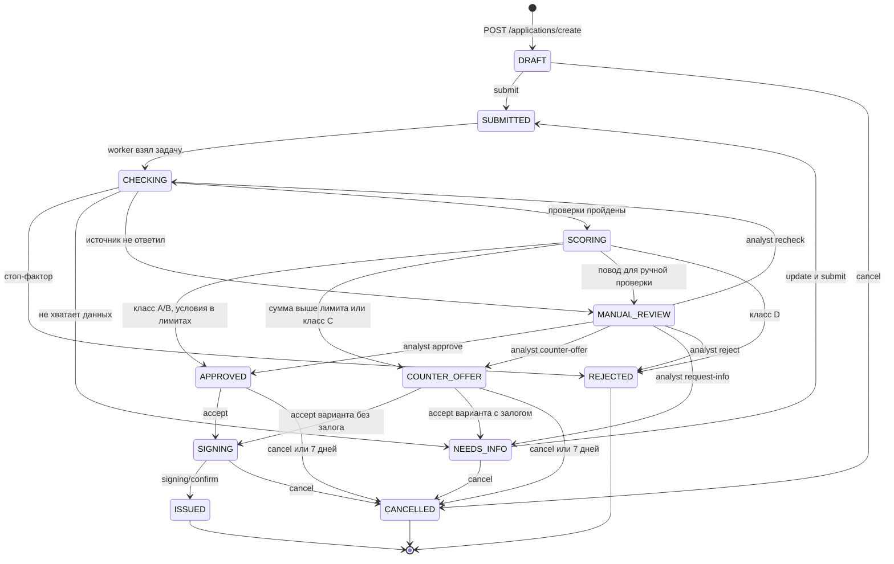
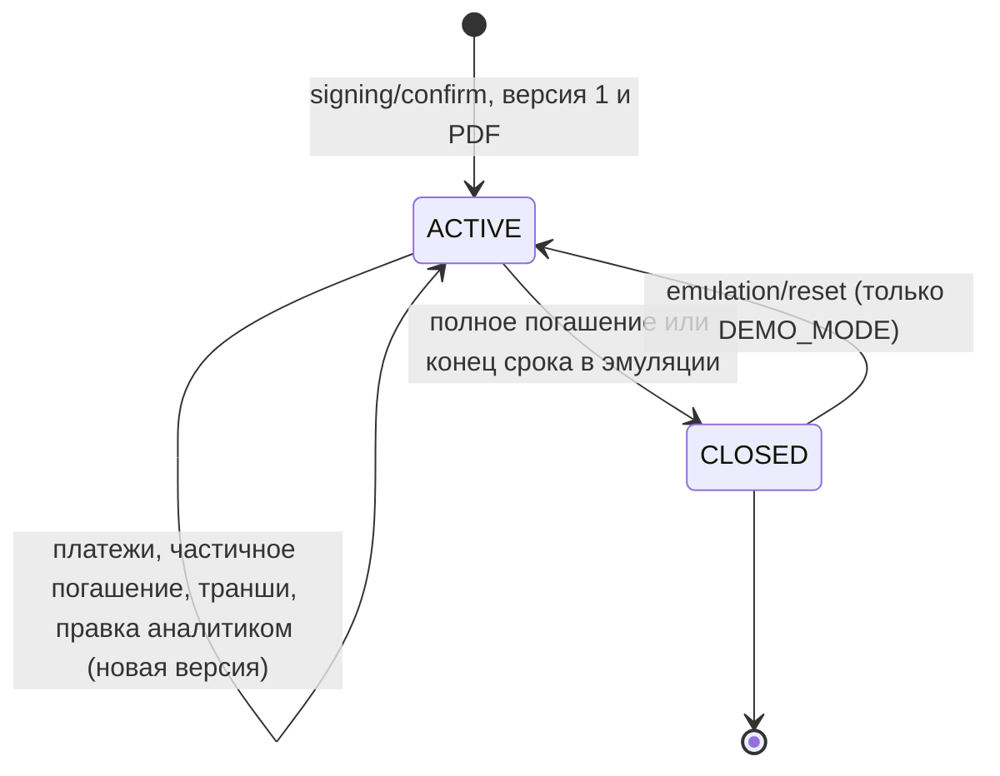

# Диаграмма состояний заявки

Статус меняется только через `ApplicationStateMachine.transition(...)` (`backend/app/domain/state_machine.py`). Переход, которого нет в таблице ниже, запрещён: API отвечает `409 INVALID_STATUS`. Каждый переход пишется в `status_transitions` и уходит клиенту и аналитику по WebSocket `/api/v1/ws/applications` событием `application.status_changed`.

| Из | В | Кто инициирует |
|---|---|---|
| DRAFT | SUBMITTED, CANCELLED | клиент |
| SUBMITTED | CHECKING | система (worker) |
| CHECKING | REJECTED, NEEDS_INFO, MANUAL_REVIEW, SCORING | система |
| NEEDS_INFO | SUBMITTED, CANCELLED | клиент |
| SCORING | APPROVED, COUNTER_OFFER, MANUAL_REVIEW, REJECTED | система |
| MANUAL_REVIEW | APPROVED, COUNTER_OFFER, NEEDS_INFO, REJECTED, CHECKING | аналитик |
| APPROVED | SIGNING | клиент |
| APPROVED | CANCELLED | клиент или `ExpirationJob` через 7 дней |
| COUNTER_OFFER | SIGNING, NEEDS_INFO | клиент |
| COUNTER_OFFER | CANCELLED | клиент или `ExpirationJob` через 7 дней |
| SIGNING | ISSUED, CANCELLED | клиент |

Активные статусы: все, кроме `ISSUED`, `REJECTED` и `CANCELLED`. По одному ИНН может быть только одна активная заявка (`409 ACTIVE_APPLICATION_EXISTS`).

Кнопки в интерфейсе берутся из `allowed_actions` в ответе API, поэтому фронтенд не дублирует таблицу переходов: `DRAFT` и `NEEDS_INFO` дают `EDIT`, `UPLOAD_STATEMENT`, `SUBMIT`, `CANCEL`; `APPROVED` и `COUNTER_OFFER` дают `ACCEPT`, `CANCEL`; `SIGNING` даёт `SIGN`, `CANCEL`.

## Договор после выдачи

Подробности правил переходов и бизнес-причин: `docs/SCOPE.md` и `backend/docs/BACKEND_SPEC.md`, раздел 5.
